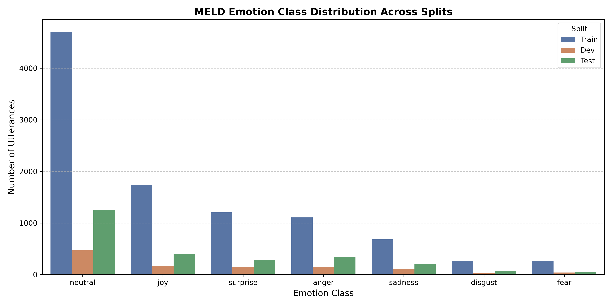

# MELD Dataset Audit Report

## 1. Overview
- **Total Utterances**: 13708
- **Total Dialogues**: 1432

## 2. Split Summary
| Split | Utterances | Dialogues | Speakers | CSV Location |
|---|---|---|---|---|
| Train | 9989 | 1038 | 260 | `data\raw\train_sent_emo.csv` |
| Dev | 1109 | 114 | 47 | `data\raw\dev_sent_emo.csv` |
| Test | 2610 | 280 | 100 | `data\raw\test_sent_emo.csv` |

## 3. Emotion Class Distribution (Class Imbalance Analysis)

| Emotion | Train Count (%) | Dev Count (%) | Test Count (%) |
|---|---|---|---|
| **neutral** | 4710 (47.15%) | 470 (42.38%) | 1256 (48.12%) |
| **joy** | 1743 (17.45%) | 163 (14.7%) | 402 (15.4%) |
| **surprise** | 1205 (12.06%) | 150 (13.53%) | 281 (10.77%) |
| **anger** | 1109 (11.1%) | 153 (13.8%) | 345 (13.22%) |
| **sadness** | 683 (6.84%) | 111 (10.01%) | 208 (7.97%) |
| **disgust** | 271 (2.71%) | 22 (1.98%) | 68 (2.61%) |
| **fear** | 268 (2.68%) | 40 (3.61%) | 50 (1.92%) |

> [!NOTE]
> Class distribution demonstrates severe imbalance: `neutral` comprises ~47% of all utterances across all splits, whereas minority classes `disgust` (~2.7%) and `fear` (~2.7%) are scarce.
> Cost-sensitive weighting (class-weighted cross-entropy) is essential to prevent majority collapse.

## 4. Modality Audit and Availability

- **Text Modality**: 100% available and verified across official train, dev, and test splits (raw transcripts, speaker names, utterance ordering).
- **Audio Modality**: Train split contains pre-extracted 1611-dimensional audio features in `archive.zip` (`audi_embeddings.pkl`). Raw audio `.wav` files are not distributed with `archive.zip`. Missing audio will trigger `missing_audio=True` mask flags.
- **Video Modality**: Raw video MP4 files (`MELD.Raw.tar`) are not present in the workspace archive. Video inputs will be processed through deterministic placeholder embeddings with `missing_video=True` mask flags as specified in task requirements.

